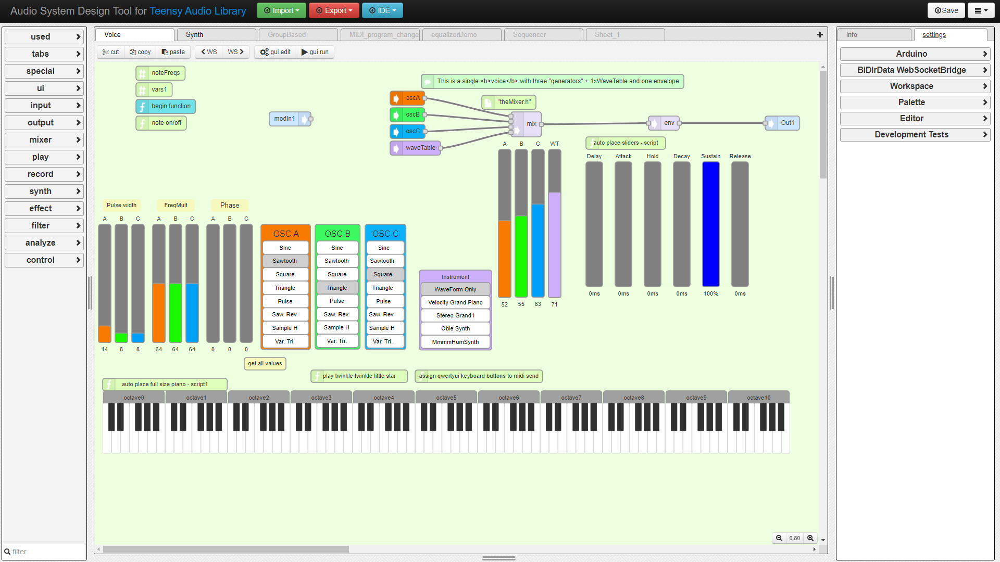
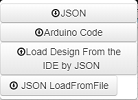
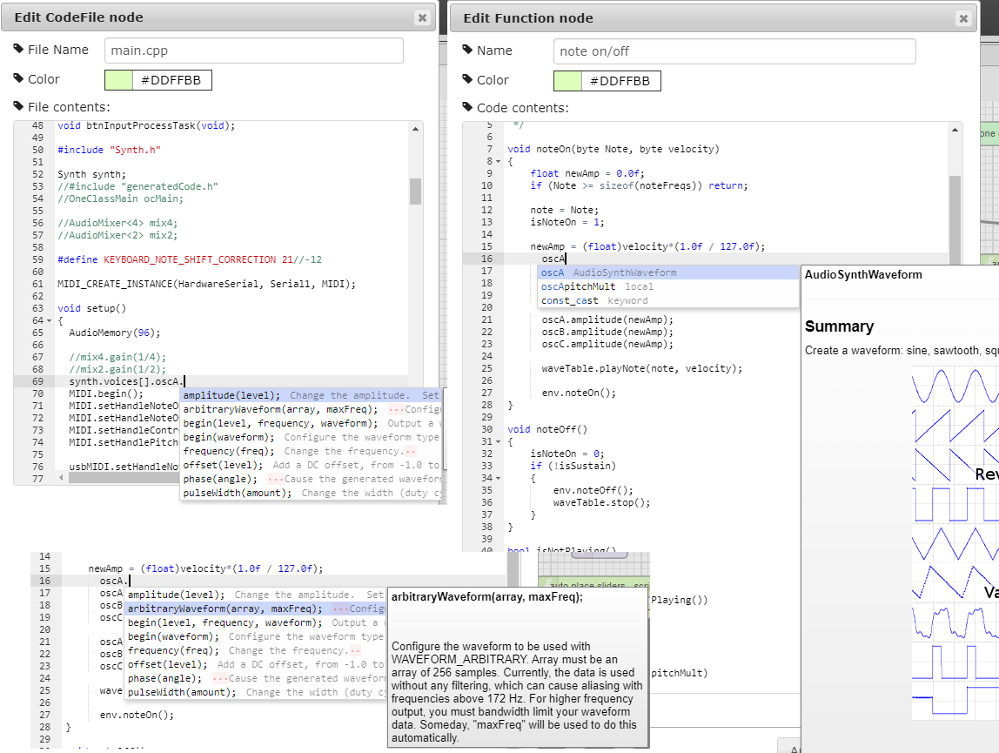
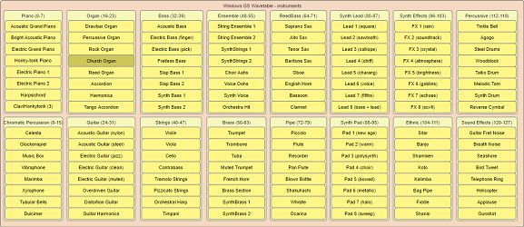
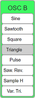
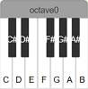
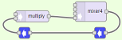

Main Screen With my project: 

I have included my complete Poly Synth Project into the html 
it's available at the rightmost menu -> Examples -> Manicken Poly Synth 
that can be exported as a zip/or using the plugin (more about that down) 

* Settings tab at the right sidebar 
where some user customizations can be done 
like project name + default include header 
settings are sorted in different categories, 
and subcategories. 
The settings are saved with the project. 

* Workspace toolbar: 
common functions cut copy paste 
workspace move left/right (to organize the tabs) 
GUI Edit/Run (only used for the UI objects) 

the toolbar can be hidden in the settings 

* Drop down Import and Export Menus 

* when exporting/saving the nodes are sorted by the visible major grid columns 
1 4 7 
2 5 8 
3 6 9 

note. the UI items are never sorted 

* Export (new) together with the Export Mode selector in the toolbar 
The Export Mode decides what is exported, and the editor shows the wires that the selected mode can't export as invalid (red dashed, with the reason in the tooltip): 
  - `classic` - the current tab as one file, with global objects (the original style)
  - `flatclassic` - the current tab as one file, class instances are converted into flat objects (`voices[2].env` becomes `voices_2_env`)
  - `flathelper` - flattened like `flatclassic`, but all objects and connections are in one helper class
  - `classes` - every exported tab (and class group) as a class in its own file, also as a zip
  - `osc_simple_cpp`, `osc_class_cpp` - the same as `flatclassic`/`classes`, but as OSC objects (h4yn0nnym0u5e's OSCAudio library)
  - `osc_simple_msg`, `osc_class_msg` - the current tab as OSC messages that create it on a running Teensy
  - `osc` - the old OSC export

The export resolves arrays, buses (wires that carry more than one signal), junctions that join/split, pass-through classes and nested classes down to plain connections. 
How it works, and the rules for arrays and buses: [red/export/README.md](red/export/README.md) 

The older Simple and Class-based exports are still in the Export menu. 

* save/load the whole design to/from a JSON file 

* create a design in parts that is then exported as different classes 
(was already in my prev. version) 

* export the whole class based design to a zip file 
for those that don't want to use the extensions and/or 
just want to make a "shippable" version 
this zip also contains the JSON in human readable format. 

* menu "buttons" that is not that obvious have popup descriptions. 

* create code directly in the "Tool" using ACE editor 
with local multilevel autocomplete, 
that means it uses the current design objects to create the autocomplete list. 
It also utilizes the embedded documentation to create the function lists, 
with descriptions both for the objects and object functions. 
Autocomplete currently don't have support for variables. 

example how the autocomplete looks: 

Code is edited in CodeFile and Function node types. 

* Bridge server (`fpb/server`, start with `npm start` in that folder) 
a local server that serves the "Tool" at http://127.0.0.1:8088/ and carries the serial port and MIDI for it: 
  - finds the Teensy by itself: with Dual Serial one port is used for OSC and the other for debug output
  - OSC goes through the bridge instead of Web Serial, so it works in any browser
  - the debug output is shown in a second log beside the output log (and a typed line is sent to the port)
  - MIDI in and out, used by the UI objects (instead of Web MIDI or the Arduino IDE plugin below)
  - it's also the Faust bridge (see Faust below)

More info: [fpb/README.md](fpb/README.md) 

* Arduino IDE plugin/extension 
https://github.com/manicken/arduinoAPIwebserver 

* VSCODE extension 
https://github.com/manicken/vscode_api_webserver 

* in short the IDE extensions is used to create a direct link between the "Tool" 
and the IDE:s (so that no copy/paste is needed). 
The extensions send all exported classes as separate files, to make nice and tidy code files. 
The extensions also make it possible to send verify/upload commands so that you can make all 
development in the "Tool". 
i.e. Just click export (simple/class) then click upload, and the changes are direcly applied 
without even touching either Arduino IDE or VSCODE. 

The extensions also capture the output of the compile output and send them to the "Tool" 
visible in the "Tool" bottom output-log 

Note. Arduino IDE compile verbose mode generates alot of information, 
so in short: the output in the "Tool" still outputs data long after the actual compile has been finished 
in the Arduino IDE. 

In VSCODE the compile don't generate so much information and that is not having any "delay" 
but in VSCODE the terminal capture is not working by default, and VSCODE needs to be started with 
the parameter --enable-proposed-api JannikSvensson.api-webserver 
(yes proposed-api is available in the standard version, even if microsoft say it's not) 
the information of doing so is available at the VSCODE extension github page. 

MIDI and serial now also go through the bridge server above, which works with any browser and IDE. 
Of the IDE extensions, only the Arduino IDE extension is supporting the "midi to websocket bridge" 
that is used by "UI item node" midiSend commands. 
This is because midi is not native in Node.js, and the node-midi (https://www.npmjs.com/package/midi) 
had some version compatibility problems in VSCODE. 

But I have made the Arduino IDE plugin .jar executable, 
that only contains the "midi to websocket bridge". 

The MIDI device selection is done in the "Tool" at the settings tab - BiDirData WebSocketBridge - MIDI 

* UI nodes (directly resizeable) 
is meant to be used together with the BiDirData WebSocketBridge 
to control a midi device from the "Tool" 
this is to make it easier to have everything in one "project". 
 
to send data to a connected midi device the sendmidi(0x90, 60, 0x3F) command is used (note. that the parameters can be mixed types) 

All UI nodes have user-selectable colors. 

UI node types currently supported: 

* group (is in the UI category) 
can contain groups of nodes, all types are supported 
can even place group into group, fully drag/drop (not like "Node-Red" group) 
completely made from scratch. 
the objects placed inside a group uses "global" position and not local (as expected), 
this is because I did not want to screw up the positions and also make it easier to code. 
the group act like a lasso-selection (but it uses a node-list to determite which nodes that is "inside") 

the group can have label that is placed inside it at the top center 
(in a future version it should be user placeable like in the "node-red"-group) 

A group with a *Class name* is a class (a class group): 
  - the group name is the instance name, `voices[8]` makes it an array of 8 instances
  - the IO junctions on the edges of the group are its ports, a port can have more than one lane (a bus port: set *Lanes* in the edit dialog of the junction)
  - the class is added to the palette (category tabs), so more instances of it can be placed, also in other tabs
  - an instance can be expanded (in its edit dialog) to show what is inside of it, read only
  - the class is exported like a class tab (in `classes` as its own class, in the flat modes as flat objects)

A group without a class name is only visual, its IO junctions works like normal junctions. 

example of grouped listboxes: 

* UI_Button 
have seperate pressed and release send data fields (the text in the field is the raw data sent) 

* UI_Slider (vertical or horizontal orientation) 
(send on move or release) 
have a bottom placed label that can show the current value 
(the text to show is parsed using javascript eval(), that means complex formulas can be used) 
have a "Send Format" field that is also parsed by the eval, example: 
"midisend(0xB0,"+d.midiId+"," + d.val + ");" 

* UI_Label 
is a borderless node with a selectable background color 

* UI_ListBox
contains a list of items and behaves like radio buttons. 
when placed in a group and the group have the checkbox "Individual ListBox Mode" unchecked they all 
behaves like a big listbox item (can be used when long list of items need to be splitted into many columns) 
sendCommand example: 
"midiSend("+(0xB0+d.midiCh)+","+d.midiId+","+d.sel ectedIndex+")" 

* UI_Piano (one octave) 
this is the most advanced (by design) node yet 
it's a single octave Piano-part (multiple can be stacked together to form a full size 128key keyboard) 

sendCommand example: 
"midiSend("+(d.keyDown+d.midiCh)+","+(d.octave*12+ d.keyIndex) +",127)" 

* UI_ScriptButton 
this is the most fun node type, 
it's used editable JavaScript that is executed when the button is pressed (in GUI run mode) 
this can be used to automate alot of things, 
I have used to automatically place the full-size keyboard above, with all sendCommands prefilled. 
Also I have used it to place the sliders used to control the envelope. 
And to make a beatiful rainbow equalizer slider-array. 

It uses the View.js as the eval base, so that every function available in View.js can be used directly. 

It can also be used for a custom export for custom structures. 

* the import and export has been drop down menus with a lot of choices 

* the palette have all categories closed by default (so its easier to find items) 
+ automatic close of other than current selected 
+ input and output have sub categories sorted by "device"(don't know what to call it) 
+ used category which contains all AudioObject-types used (to make it easier to make copies of used objects) 
+ the category tabs, that contains the class IO nodes (TabInput/TabOutput) + all class nodes (class tabs and class groups) 

* print function at right menu/(ctrl+p) that only uses the workspace-area as the print source 

* save button (ctrl+s) to ensure that the design is saved 
save notification that shows when the design is saved 

* Junction Nodes (used to split many signals and to make the design easier to follow) 
have two variants one that goes in normal direction L-R 
and one that goes in the reverse direction 
a junction with more inputs joins them into one bus wire, and a junction with more outputs splits a bus/array wire 
(the old BusJoin/BusSplit objects are converted to junctions when a design is loaded) 

* Wire colors (in the C++ Export Modes) show what a wire carries: 
orange for an array, blue for a bus, and a mixed wire (i.e. array[2] of bus[2]) is the outer color with dashes in the inner color. 
The tooltip of a wire shows what it carries. 

example of R-L junction usage: 

* OSC live update (the toolbar button) 
changes the design on a Teensy running h4yn0nnym0u5e's OSCAudio library with the Dynamic Audio Objects, while it's edited: 
objects, wires, junctions, classes (all instances), arrays, class groups, paste and undo/redo are sent as they happen. 
Sync clears the Teensy and sends the whole design of the current tab. 
Used to prototype a design before it's made into fixed firmware. 

* Live tab (right sidebar) 
controls the audio objects on the Teensy live: it shows the functions of the selected audio object 
(i.e. frequency, amplitude, gain of each mixer channel) as sliders, lists and buttons. 
For an object in a class or an array, it can control all instances or one of them. 
"+" (or "Create GUI" for all of them) creates UI objects (sliders, list boxes, buttons) that are bound to the audio object, 
so a control panel can be made beside the design. Only OSC is supported for now. 

* Faust (AudioEffectFPB) 
a Faust patch can be written in the Faust IDE or in the "Tool" (the edit dialog of an AudioEffectFPB object), 
the bridge server compiles it into FPB (float patch bytecode) and the "Tool" sends it to the Teensy over OSC, 
where it's loaded and run without compiling the firmware again. The Faust parameters show up in the Live tab. 
How to set it up: [fpb/README.md](fpb/README.md), how FPB works on the Teensy: [fpb/teensy/FPB/README.md](fpb/teensy/FPB/README.md) 

* Test designs (rightmost menu -> Test designs) 
designs made for testing the export (`tests/export/*.js`), see [red/export/README.md](red/export/README.md) (Tests) for what each one must export. 

I tried my best to make the embedded documentation as clear as possible, 
but contributions is appreciated. 
Or if there is something that needs more explanation, please let me know. 

List of future plans (in priority order): 

* tidy up the node label/text redraw code 
(to make it more efficient because the getTextSize is taking alot of time) 
so buffering of the textDimensions is needed for all labels/texts 

* Make a very simple sequencer with the help of piano as guide and group with lines for the sequence part 
the notes/actions should be done with the UI_Button (because it have both pressed(enter) and released(leave) actions) 

* multitab code editor 

Done from the earlier list: group export as class (class groups, see group above), 
and the "exploded" export where a design is defined in tabs but exported as one file (the Export Modes `flatclassic` and `flathelper`). 
